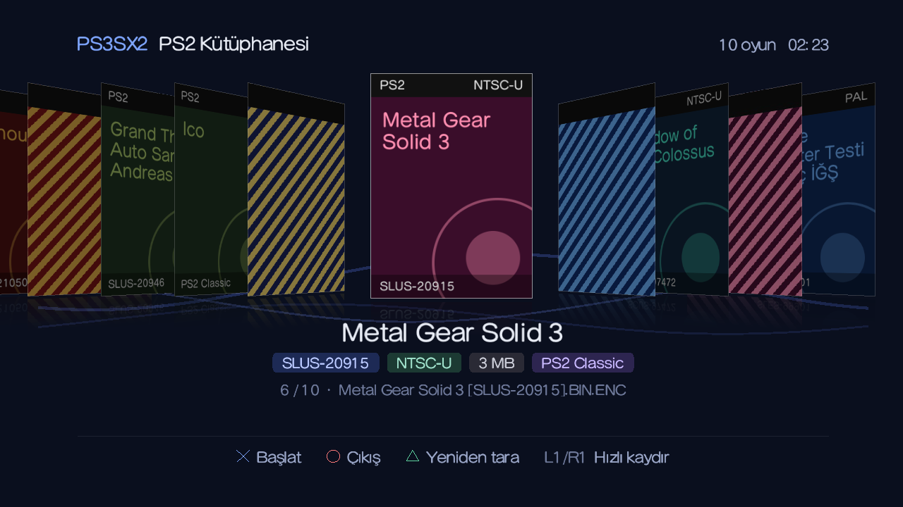

# PS3SX2

[English](README.md) | **Türkçe**

**PS3 Slim ve Super Slim** için kapak akışlı (cover flow) bir PS2 oyun başlatıcısı.



<sub>RPCS3'te test kütüphanesiyle çalışırken. Kapak resmi olmayan oyunlara kapak üretiliyor.</sub>

Bu modellerde PS2 çipleri olmadığı için PS2 diskleri çalışmaz. Ama sistem yazılımında
Sony'nin PS2 yazılım emülatörü `ps2_netemu` hâlâ duruyor; PlayStation Store'daki PS2
Classics oyunları onunla çalışıyor. PS3SX2, `PS2ISO` klasöründeki oyunları bir kapak
rafı olarak listeler. Birini seçtiğinde oyunu bu emülatöre teslim eder.

İsim "PS3 Slim × PS2" diye okunur: S Slim'den, X oyunu başlatan ✕ tuşundan, 2 de
PS2'den geliyor.

> **Durum: erken geliştirme aşamasında.** Arayüz RPCS3 emülatöründe çalışıyor, ama gerçek
> bir konsolda henüz hiçbir şey denenmedi; bir oyunu sonuna kadar başlatmak da buna dahil.
> Pürüzler olabilir, bulduklarını bildirirsen sevinirim.

## Özellikler

- Dahili diskteki ve tüm USB portlarındaki (`/dev_usb000` - `/dev_usb007`) `PS2ISO` klasörünü tarar
- Her oyunun seri kodunu (`SLUS-20946`) doğrudan disk imajındaki `SYSTEM.CNF`'den okur,
  imaj şifreliyse dosya adından alır
- 3D kapak rafı: seçili kapak sana bakar, diğerleri iki yanda açılı durur
- Seçili kapağın altında oyunun adı, seri kodu, bölgesi, boyutu ve formatı
- PNG veya JPG kapaklar, boyut sınırı yok
- Türkçe ve İngilizce arayüz, konsolun sistem diline göre otomatik seçilir
- Cobra'lı CFW'de `.iso` oyunlarını kendisi PS2 diski olarak takar: webMAN MOD ya da
  başka bir araç gerekmez, tek paket yeterli
- Eksik kapakları seri koda göre arka planda kendisi indirir, istersen □ ile de
- Topluluğun yaklaşık 1.400 oyun için hazırladığı `ps2_netemu` düzeltmelerini içinde taşır
  ve bir `.iso` başlarken doğru olanı otomatik uygular
- `.BIN.ENC` oyunları PS2 Classics Placeholder'a yükler (HEN ve CFW'de), sonra
  placeholder'ı XMB'den başlatırsın

## Uyumluluk

| Konsol | Yazılım | `.iso` | `.BIN.ENC` (PS2 Classic) |
|---|---|---|---|
| Slim, CFW kurulabilen (ör. CECH-25xx) | Cobra'lı CFW | Çalışıyor (CECH-2504A'da denendi) | Yazıldı, test edilmedi |
| Slim | HEN | HEN'de mümkün değil | Yazıldı, test edilmedi |
| Super Slim (CECH-4xxx) | HEN | HEN'de mümkün değil | Yazıldı, test edilmedi |

HEN, PS2 ISO bağlayamıyor. Bu yüzden HEN'de her oyunun `.BIN.ENC` olması gerekiyor.
İki başlatma yolunun ayrıntıları [docs/launching.md](docs/launching.md) dosyasında
(İngilizce).

## Konsolda gerekenler

**Cobra'lı CFW:** yalnızca PS3SX2. Cobra CFW'nin, `ps2_netemu` da sistem yazılımının
içinde geliyor. `.iso` oyunlarını `/dev_hdd0/PS2ISO` klasörüne koy; Cobra PS2 imajlarını
yalnızca dahili diskten takabiliyor.

**HEN:** **PS2 Classics Placeholder** (`/dev_hdd0/game/PS2U10000`) ve sahip olduğun
disklerden PS2 Classics GUI gibi bir PC aracıyla hazırlanmış `.BIN.ENC` oyunlar. Bunlar
dahili diskte ya da USB bellekte durabilir.

```
/dev_hdd0/PS2ISO/                       (.BIN.ENC'ler /dev_usb000/PS2ISO/'da da olabilir)
├── God of War II.iso
├── God of War II.iso.CONFIG                 ps2_netemu düzeltmeleri, otomatik eklenir
├── Burnout 3 [SLUS-21050].BIN.ENC
├── Burnout 3 [SLUS-21050].BIN.ENC.CONFIG    isteğe bağlı ps2_netemu ayarları
└── covers/
    ├── SCUS-97481.png
    └── SLUS-21050.jpg
```

### Oyun düzeltmeleri (CONFIG)

`ps2_netemu` her oyunu kusursuz çalıştırmıyor: bazıları intro videosu atlanınca donuyor,
siyah ekranda kalıyor ya da basınca duyarlı tuşlara ihtiyaç duyuyor. PS3 topluluğu yaklaşık
1.400 oyun için bu sorunları düzelten küçük CONFIG dosyaları hazırladı; PS3SX2 bunları
paketinde taşıyor. Bir `.iso` başlattığında oyunun seri koduna uyanı ISO'nun yanına
`<oyun>.iso.CONFIG` olarak koyuyor, Cobra da onu emülatöre veriyor.

- Senin oraya koyduğun bir CONFIG asla değiştirilmez.
- Konsolda webMAN MOD'un CONFIG veritabanı kuruluysa bizde olmayan oyunlar için onunkiler kullanılır.
- CONFIG'ler [webMAN MOD](https://github.com/aldostools/webMAN-MOD/tree/master/_Projects_/updater/PS2CONFIG)'dan
  geliyor; ne değiştirdiklerini [psdevwiki](https://www.psdevwiki.com/ps3/PS2_Custom_Configs) anlatıyor.

Örnek: Pro Evolution Soccer 6 düzeltme olmadan intro atlanınca donuyor, düzeltmeyle sorunsuz
oynanıyor.

### Kapaklar

PS3SX2 kapağı şu sırayla arar:

1. `PS2ISO/covers/<SERİ KOD>.png` veya `.jpg`, örneğin `covers/SLUS-21050.jpg`
2. Oyunun yanında, oyunla aynı adı taşıyan resim: `Burnout 3 [SLUS-21050].png`

Kapağı olmayan oyuna, adı, bölgesi ve seri koduyla renkli bir kapak üretilir. Resimler
yüklenirken 256×360'a küçültülür.

**Kapak indirme:** konsol internete bağlıysa PS3SX2 açılır açılmaz eksik kapakları arka planda
kendisi indirir; seri koda göre, PCSX2 kullanıcılarının kullandığı
[xlenore/ps2-covers](https://github.com/xlenore/ps2-covers) arşivinden. Bu sırada gezinmeye
devam edebilirsin: her kapak indikçe ekrana gelir, başlıkta da "Kapaklar 3/5" yazar. Kapaklar
oyunların yanına `covers/<SERİ KOD>.jpg` olarak kaydedilir ve o andan sonra internet olmadan
da görünür. Arşivde olmayan oyunlar üretilen kapakla kalır. □ aynı indirmeyi ilerleme çubuğu
ve özetle ön planda yapar, örneğin tekrar denemek için.

- Kutu tasarımları telifli olduğu için ne bu repoda ne de pakette kapak resmi var; konsol
  onları sen istediğinde indiriyor.
- Başka bir arşiv kullanmak için adresini, seri kodun geleceği yere `%s` koyarak
  `/dev_hdd0/PS2ISO/covers_url.txt` dosyasına yaz, ör. `https://example.com/ps2/%s.jpg`.
- Bağlantılar şifreli ve Mozilla'nın sertifika listesine göre doğrulanıyor; bu yüzden
  konsolun tarih ve saatinin doğru olması gerekiyor.

### Dosya adları

Görünen başlık dosya adından üretilir. Seri kod etiketleri silinir, `_` boşluğa
dönüşür. Aşağıdakilerin hepsi "Burnout 3" olarak görünür:

```
Burnout 3.iso
Burnout 3 [SLUS-21050].BIN.ENC
SLUS_210.50.Burnout_3.iso        Open PS2 Loader adlandırması
```

`.BIN.ENC` dosyalarında seri kod yalnızca dosya adından okunabilir. Kapakların seri
koda göre bulunmasını istiyorsan kodu dosya adında bırak.

## Kontroller

| Tuş | İşlev |
|---|---|
| Sol / Sağ | Önceki / sonraki oyun (basılı tutunca kayar) |
| L1 / R1 | 5 oyun atla |
| ✕ | Seçili oyunu başlat |
| △ | Klasörleri yeniden tara |
| □ | Eksik kapakları hemen indir (kendiliğinden de inerler) |
| ○ | Çıkış ya da kopyalamayı veya indirmeyi iptal |

## Derleme

Birim testleri C derleyicisi olan her makinede çalışır, PS3 araç zinciri gerekmez:

```bash
make test
```

PS3 paketi için [PSL1GHT](https://github.com/ps3dev/PSL1GHT) (açık kaynak PS3 SDK'sı),
FreeType için [ps3libraries](https://github.com/bucanero/ps3libraries) ve libfont ile
birlikte [Tiny3D](https://github.com/wargio/tiny3D) gerekir:

```bash
export PS3DEV=/usr/local/ps3dev
export PSL1GHT=$PS3DEV
make pkg
```

Sonuç `ps3sx2.pkg` dosyasıdır. GitHub'a yapılan her push'ta da derlenir: **Actions**
sekmesinden bir çalıştırmayı açıp `ps3sx2-…` çıktısını indirebilirsin.

### Kaynak düzeni

| Yol | İçinde ne var |
|---|---|
| `source/main.c` | Ana döngü, kol girişi, başlatma akışı |
| `source/gfx.c` | Tiny3D çizimi: kapak rafı, yazı, kapak dokuları |
| `source/library.c` | Klasör tarama, dosya adından başlık |
| `source/iso9660.c` | Normal ve ham disk imajlarından `SYSTEM.CNF` okuma |
| `source/serial.c` | `SYSTEM.CNF` ve dosya adında seri kod bulma, bölge tespiti |
| `source/launcher.c` | PS2 Classics kopyalama ve ISO takma kuralları |
| `source/cobra.c` | PS2 ISO takan Cobra sistem çağrıları (IRISMAN'dan uyarlandı) |
| `source/coverflow.c` | Kapak rafı yerleşimi ve animasyon hesapları |
| `source/canvas.c` | Üretilen kapaklar için küçük yazılımsal çizim modülü |
| `source/coverdl.c`, `source/net.c`, `source/autocovers.c` | Eksik kapak indirme, arka planda ya da istenince; curl ve mbedTLS ile HTTPS |
| `source/covers.c` | Her oyunun kapağının aranacağı yerler |
| `source/lang.c`, `source/text.c` | Türkçe ve İngilizce metinler, UTF-8'den font kodlamasına çeviri |
| `tests/` | `main.c`, `gfx.c`, `cobra.c`, `net.c` ve `autocovers.c` dışındaki her şey için birim testleri |

PS3 API'lerine yalnızca `main.c`, `gfx.c`, `cobra.c`, `net.c` ve `autocovers.c` dokunur. Yeni mantığı ayrı bir modüle koy
ki `make test` ile test edilebilsin.

## Yol haritası

- [x] RPCS3'te çalıştırıp kapak rafını tasarıma göre ayarlamak
- [ ] Gerçek konsolda çalıştırıp bir oyunu baştan sona başlatmak
- [x] CFW'de düz `.iso` oyunları Cobra ile başlatmak (konsolda test edilmeli)
- [ ] USB bellekteki `.iso` oyunlarını takmak
- [ ] XMB'ye dönmek yerine placeholder'ı doğrudan başlatmak
- [ ] FAT32 USB'lerdeki parçalı `.iso.0` / `.iso.1` imajları
- [x] Hazır `ps2_netemu` CONFIG veritabanı (topluluk CONFIG'leri)
- [ ] Kapak yansımaları, analog çubuk, ayarlar ekranı
- [ ] Daha fazla dil

## Katkı

Issue ve pull request'ler açıktır. Pull request açmadan önce:

- `make test` çalıştır ve geçtiğinden emin ol
- PS3'ten bağımsız mantığı testleriyle birlikte kendi modülüne koy
- yeni bir dil eklemek için onu `lang_id`'ye ekle ve `source/lang.c`'de sütununu doldur.
  Testler her metnin fontla çizilebildiğini kontrol eder.

## Yasal

PS3SX2'nin Sony Interactive Entertainment ile bir bağı yoktur, onlar tarafından
desteklenmez. "PlayStation", "PS2" ve "PS3" sahiplerinin ticari markalarıdır.

Bu repoda oyun, sistem yazılımı, BIOS, emülatör dosyası ya da kapak resmi yoktur ve
eklenmemelidir. Sahip olduğun disklerdeki oyunları kullan.

## Lisans

[GNU GPL v3](LICENSE).

## Teşekkürler

- [PSL1GHT](https://github.com/ps3dev/PSL1GHT) ve ps3dev topluluğu
- Çizim ve fontlar için Hermes'in [Tiny3D](https://github.com/wargio/tiny3D)'si
- PS2 oyunlarının nasıl bağlandığını kaynak koduyla belgeleyen aldostools'un
  [webMAN MOD](https://github.com/aldostools/webMAN-MOD)'u
- `source/cobra.c`'deki Cobra kodunun uyarlandığı, aldostools ve katkıcılarının
  [IRISMAN](https://github.com/aldostools/IRISMAN)'ı (GPL-3.0)
- `pkgfiles/USRDIR/ps2config` içindeki `ps2_netemu` özel CONFIG'lerini yazan ve derleyen herkes
- Bu projenin CI kurulumuna ve ağ koduna temel olan bucanero'nun
  [Apollo Save Tool](https://github.com/bucanero/apollo-ps3)'u
- Kapakların indirildiği [xlenore/ps2-covers](https://github.com/xlenore/ps2-covers) arşivi
- [curl](https://curl.se/docs/caextract.html) projesinin derlediği Mozilla kök sertifikaları
  (`pkgfiles/USRDIR/cacert.pem`, MPL 2.0)
